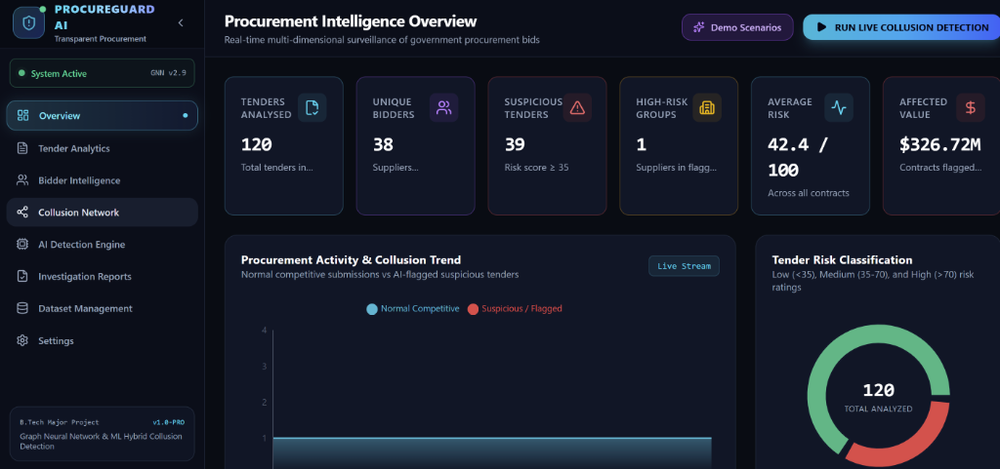
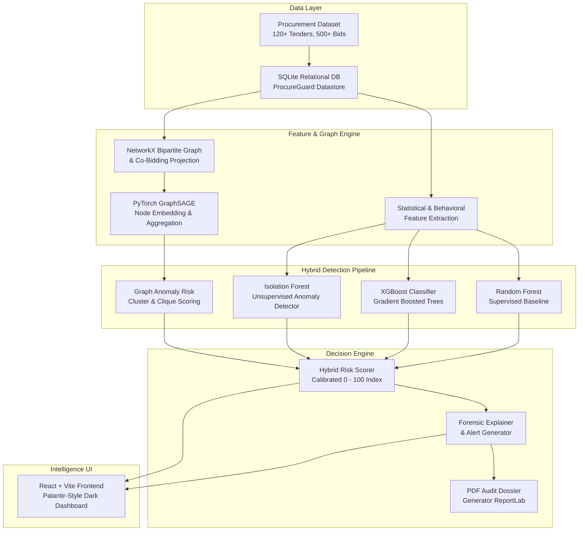

# PROCUREGUARD AI
### *Intelligence for Transparent Procurement*
**AI-Based Detection of Bid Rigging and Collusion in E-Procurement Systems**  
*B.Tech Major Project Prototype & Forensic Decision Support Platform*

<div align="center">
  <br/>
  
  <p><i>Figure 1: ProcureGuard AI Intelligence Dashboard — Surveillance Overview, Forensic KPIs, Collusion Activity Timeline & Risk Distribution</i></p>
  <br/>
</div>

---

## 1. Executive Summary & Objective

In public procurement, corrupt cartels and bidding rings inflate taxpayer costs by coordinating secretly to subvert competitive bidding. Traditional keyword searches and manual audits struggle to uncover subtle mathematical and network coordination.

**PROCUREGUARD AI** is an intelligent, full-stack e-procurement monitoring and surveillance platform designed to uncover collusive behavior using a hybrid machine learning pipeline:
- **Statistical & Behavioral Forensic Feature Extraction**
- **Supervised Classification:** Random Forest and XGBoost
- **Unsupervised Anomaly Detection:** Isolation Forest
- **Graph Neural Network:** Native 2-layer GraphSAGE architecture (Hamilton et al., NeurIPS 2017) with mean neighborhood aggregation
- **Network Analysis:** NetworkX bipartite graphs, Louvain/greedy modularity community detection, and Jaccard co-participation similarity
- **Forensic PDF Dossier Generation:** ReportLab-powered official audit packages

---

## 2. System Architecture



### Hybrid Risk Scoring Formula
The hybrid risk index is calibrated from $0.0$ to $100.0$:
$$\text{Risk Score} = \Big(0.28 \cdot P_{\text{RF}} + 0.32 \cdot P_{\text{XGB}} + 0.20 \cdot S_{\text{IsoForest}} + 0.20 \cdot S_{\text{GNN\_SAGE}}\Big) \times 100$$
- **Low Risk:** $< 35$ (Healthy competitive market dynamics)
- **Medium Risk:** $35 - 70$ (Elevated price pegging or co-bidding patterns)
- **High Risk:** $> 70$ (High probability collusion ring flagged for forensic investigation)

*Regulatory Notice: A high risk score indicates an anomaly requiring human investigation; it does not constitute conclusive legal proof of antitrust crime.*

---

## 3. Technology Stack

### Backend
- **Language & Runtime:** Python 3.11+
- **API Framework:** FastAPI & Uvicorn ASGI Server
- **Machine Learning:** Scikit-learn, XGBoost
- **Graph Neural Network & Graph Analytics:** PyTorch 2.9 (GraphSAGE module) & NetworkX
- **Data Engineering:** Pandas & NumPy
- **Database:** SQLite
- **Forensic PDF Dossiers:** ReportLab

### Frontend
- **Framework:** React 19 + Vite 6
- **Styling:** Tailwind CSS v4 (Palantir-style cyber intelligence dark theme)
- **Icons:** Lucide React
- **Data Visualizations:** Recharts (Activity Timeline, Risk Distribution Donut, Category Bar Chart, Feature Importance Chart)
- **Network Visualizer:** Interactive SVG/Canvas Bipartite Graph with Zoom, Pan, Drag, and Neighbor Highlighting

---

## 4. Project Structure

```
procureguard-ai/
├── backend/
│   ├── app/
│   │   ├── main.py                     # FastAPI application entrypoint
│   │   ├── api/
│   │   │   ├── dashboard.py            # KPI metrics, timeline, geography
│   │   │   ├── tenders.py              # Filterable tenders & drilldown
│   │   │   ├── bidders.py              # Supplier profiles & win stats
│   │   │   ├── network.py              # Bipartite co-bidding graph API
│   │   │   ├── alerts.py               # Alert listing & status management
│   │   │   ├── detect.py               # Full live detection pipeline execution
│   │   │   ├── dataset.py              # CSV upload, sanitize, raw download
│   │   │   ├── reports.py              # PDF dossier generation & streaming
│   │   │   └── demo.py                 # College presentation demonstration scenarios
│   │   ├── detection/
│   │   │   ├── features.py             # 13 engineered statistical features
│   │   │   ├── ml_models.py            # RF, XGBoost, Isolation Forest
│   │   │   ├── gnn_model.py            # PyTorch GraphSAGE message-passing layer
│   │   │   └── hybrid_engine.py        # Ensemble synthesis & database commit
│   │   ├── graph/
│   │   │   ├── builder.py              # NetworkX bipartite & co-bid graphs
│   │   │   └── analysis.py             # Cliques, communities, Jaccard similarity
│   │   ├── database/
│   │   │   └── db.py                   # SQLite schema initialization
│   │   └── services/
│   │       ├── data_generator.py       # Realistic 120-tender synthetic dataset
│   │       └── report_generator.py     # PDF forensic dossier generator
│   ├── datasets/                       # SQLite DB, raw and processed CSVs
│   ├── reports/                        # Exported PDF forensic dossiers
│   └── Dockerfile
├── frontend/
│   ├── src/
│   │   ├── components/
│   │   │   ├── Sidebar.jsx             # Collapsible Palantir-style navigation
│   │   │   ├── Header.jsx              # Status bar & "RUN LIVE COLLUSION DETECTION"
│   │   │   ├── StatCard.jsx            # Dynamic KPI metrics with glow
│   │   │   ├── RiskBadge.jsx           # Low, Medium, High visual badges
│   │   │   ├── Modal.jsx               # Accessible dialog container
│   │   │   └── DemoScenarioModal.jsx   # College presentation scenario runner
│   │   ├── pages/
│   │   │   ├── Overview.jsx            # Main dashboard overview
│   │   │   ├── Tenders.jsx             # Filterable tender explorer & modal
│   │   │   ├── Bidders.jsx             # Supplier behavioral directory
│   │   │   ├── NetworkView.jsx         # Interactive co-bidding network
│   │   │   ├── DetectionEngine.jsx     # Active ML models & feature importances
│   │   │   ├── Reports.jsx             # Anti-corruption alerts & status updater
│   │   │   ├── DatasetManager.jsx      # CSV ingest & data download
│   │   │   └── Settings.jsx            # Thresholds & ensemble weights
│   │   ├── charts/
│   │   │   ├── TimelineChart.jsx       # Recharts area graph
│   │   │   ├── RiskDonutChart.jsx      # Recharts risk breakdown donut
│   │   │   ├── CategoryBarChart.jsx    # Sector volume & risk exposure
│   │   │   └── FeatureImportanceChart.jsx
│   │   ├── services/
│   │   │   └── api.js                  # Axios/Fetch API client
│   │   ├── App.jsx                     # Root application container
│   │   └── index.css                   # Custom dark cyber intelligence styles
│   ├── package.json
│   ├── vite.config.js
│   └── Dockerfile
├── docker-compose.yml
├── requirements.txt
└── README.md
```

---

## 5. Quickstart Guide (Local Running)

### Prerequisites
- Python 3.10+
- Node.js 18+ and npm

### Step 1: Start Backend Server
```powershell
cd procureguard-ai/backend
python -m uvicorn app.main:app --host 127.0.0.1 --port 8000 --reload
```
*The backend automatically initializes the SQLite database, generates the 120-tender benchmark dataset, and executes the baseline detection engine on startup.*

Verify backend: `http://127.0.0.1:8000/docs` (Interactive Swagger API documentation).

### Step 2: Start Frontend Application
In a separate terminal:
```powershell
cd procureguard-ai/frontend
npm run dev
```
Open your browser at: `http://localhost:5173/`

---

## 6. Docker Deployment

To launch the complete application with Docker Compose:
```bash
cd procureguard-ai
docker-compose up --build
```
- Frontend: `http://localhost:5173`
- Backend API: `http://localhost:8000`

---

## 7. College Project Presentation Walkthrough

When presenting your B.Tech project to examiners, follow this 5-minute demonstration flow:

1. **Dashboard Overview:**
   - Point out the 6 real-time KPI cards connected directly to the SQLite backend.
   - Show the **Tender Activity & Collusion Trend** chart contrasting normal competitive bids against flagged anomalies.
   - Highlight the **Potentially Affected Contract Value** indicator.

2. **The "RUN LIVE COLLUSION DETECTION" Button:**
   - Click the prominent **"RUN LIVE COLLUSION DETECTION"** button in the header.
   - Explain how this triggers the FastAPI backend to execute data pre-processing, 13-feature extraction, NetworkX graph construction, PyTorch GraphSAGE neighbor aggregation, and hybrid scoring.

3. **Three Predefined Scenarios (Click "Demo Scenarios"):**
   - **Scenario 1 (Normal Competitive):** Show how authentic tenders with 5 independent contractors exhibit healthy price dispersion ($CV > 6\%$), independent IP subnets, and low risk ratings ($< 30$).
   - **Scenario 2 (Bid Rotation Cartel):** Examine *Cartel Ring Alpha* (Apex Infra, BuildTech Corp, Vertex Engineering). Show how the winner systematically alternates while co-bidding repeatedly from identical IP subnets ($192.168.42.x$), triggering an $85+$ High Risk rating.
   - **Scenario 3 (Cover Bidding / Sham Bidding):** Examine *Cartel Ring Beta* (MedSupply Direct, HealthCare Global, BioPharma Direct). Show how the winning quote is pegged at $99.2\%$ of the government estimate while companion quotes submit parallel token bids differing by exact $0.8\%$ offsets.

4. **Interactive Collusion Network:**
   - Navigate to **Collusion Network**.
   - Zoom and pan across the graph. Click any node (e.g. Apex Infra) to highlight its co-bidding clique and view topological centrality metrics in the Inspector panel.

5. **Investigation Reports & PDF Export:**
   - Navigate to **Investigation Reports**.
   - Show how auditors can change the status of alerts (`New` $\to$ `Under Review` $\to$ `Escalated`).
   - Click **"Download Official PDF Dossier"** to open the generated, formal investigation dossier produced using ReportLab.

---

## 8. API Reference

| Endpoint | Method | Description |
|---|---|---|
| `/api/dashboard` | GET | KPI metrics, activity timeline, risk distributions, geography |
| `/api/tenders` | GET | Filterable tender explorer (by risk, category, location, query) |
| `/api/tenders/{tender_id}` | GET | Detailed tender dossier, all bids, winning margins, overlap |
| `/api/bidders` | GET | List suppliers with win rates, contracts won, risk ratings |
| `/api/bidders/{bidder_id}` | GET | Bidder profile, co-bidding partners, historical submissions |
| `/api/network` | GET | Bipartite & projected co-bidding graph nodes and edges |
| `/api/alerts` | GET | List surveillance alerts filtered by case status |
| `/api/alerts/{alert_id}` | PATCH | Update case status (New, Under Review, Escalated, Closed) |
| `/api/detect` | POST | Trigger full live hybrid detection pipeline |
| `/api/dataset/upload` | POST | Ingest, sanitize, and validate external procurement CSV |
| `/api/dataset/download/raw` | GET | Download raw procurement bids CSV |
| `/api/dataset/download/processed` | GET | Download engineered features CSV |
| `/api/dataset/reset-sample` | POST | Restore standard 120-tender synthetic benchmark |
| `/api/reports/{tender_id}/pdf` | GET | Stream official PDF forensic investigation dossier |
| `/api/demo/scenarios` | GET | Retrieve presentation demo scenarios |
| `/api/demo/run-full-detection`| POST | Execute live demonstration pipeline |

---

## 9. Academic Integrity & Ground-Truth Quarantining

To adhere to rigorous machine learning standards:
- The simulated ground truth labels (`Normal Competitive`, `Simulated Bid Rotation`, `Simulated Cover Bidding`) are explicitly stored in separate database columns and are **never** passed into model training as features.
- Model predictions and risk ratings are computed exclusively from mathematical observables (price margins, ratios, variances, graph neighbor embeddings, and network centralities).
